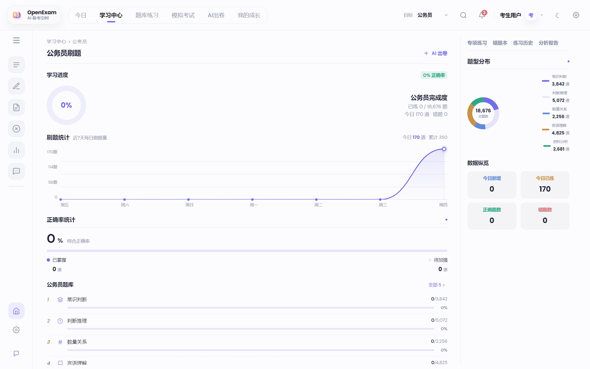
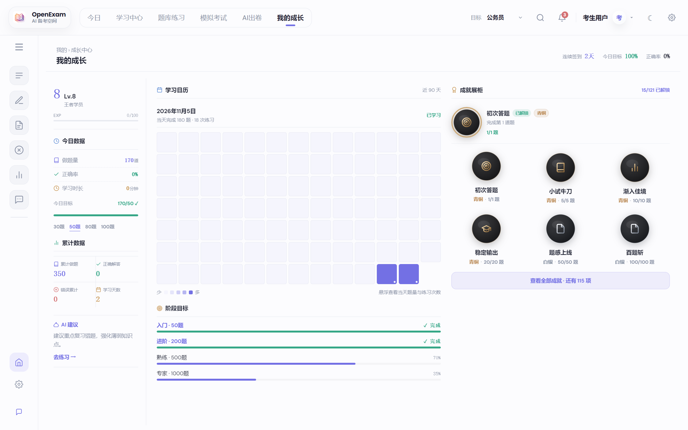
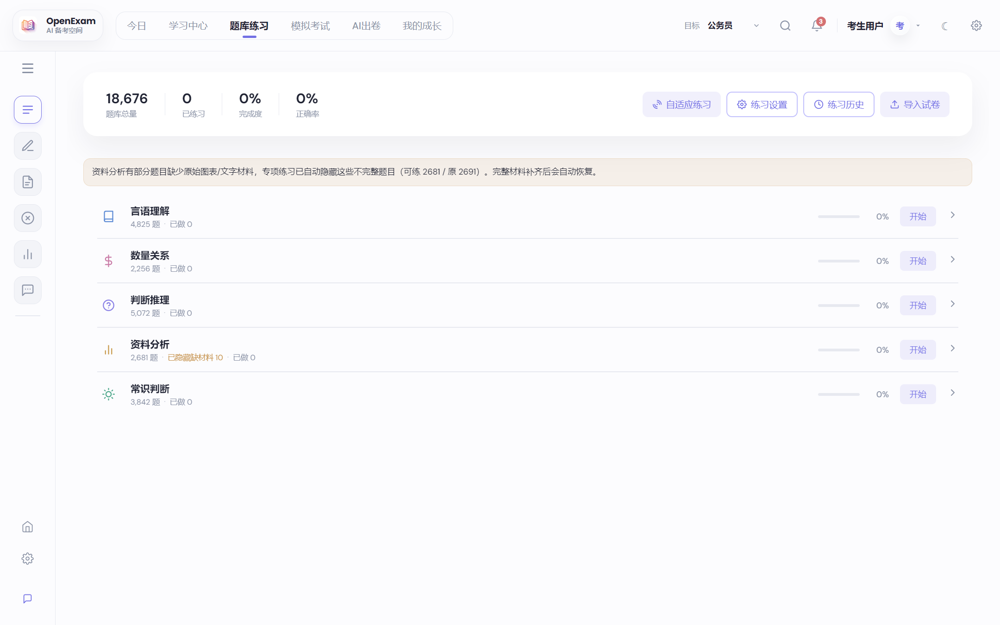
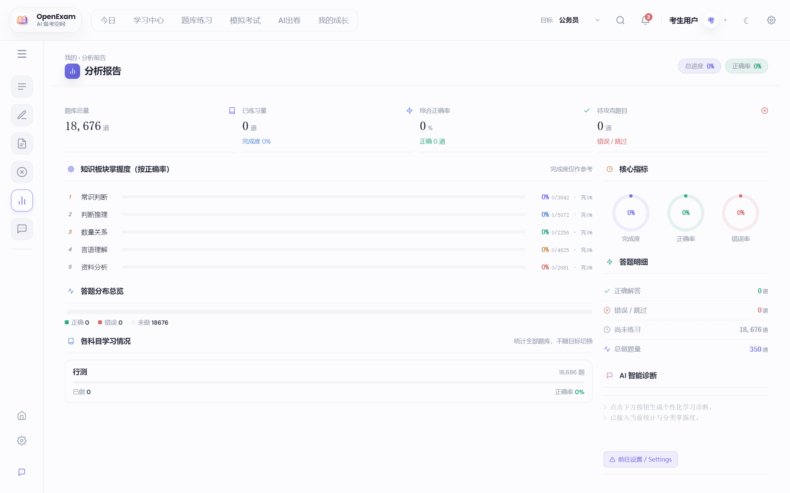
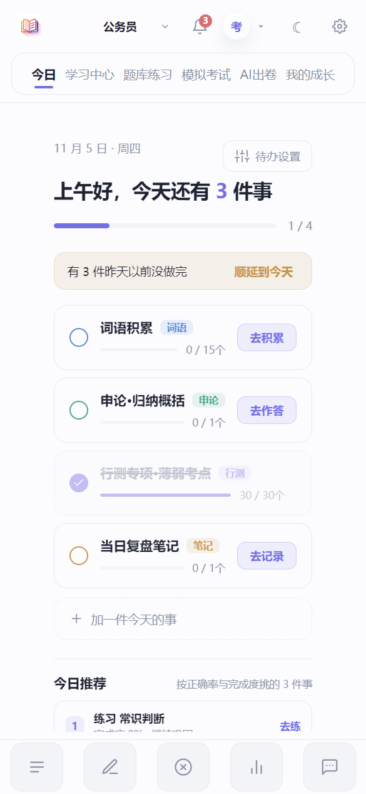
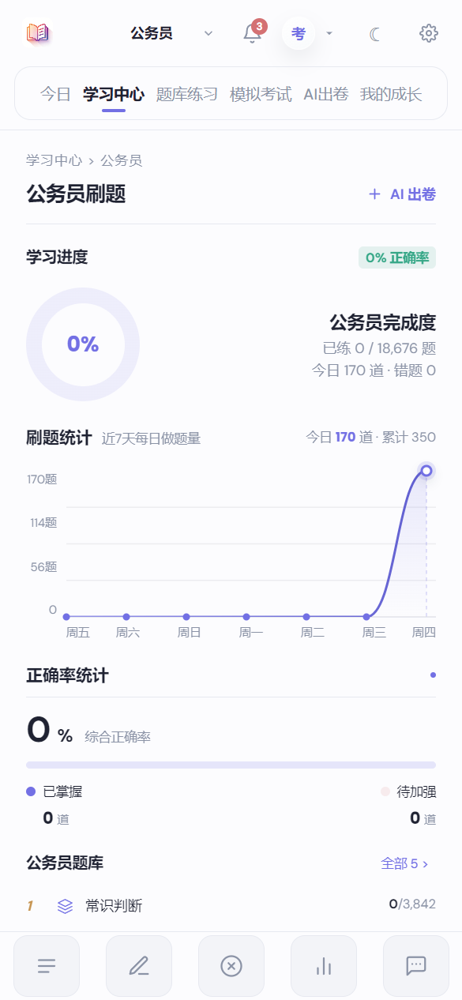
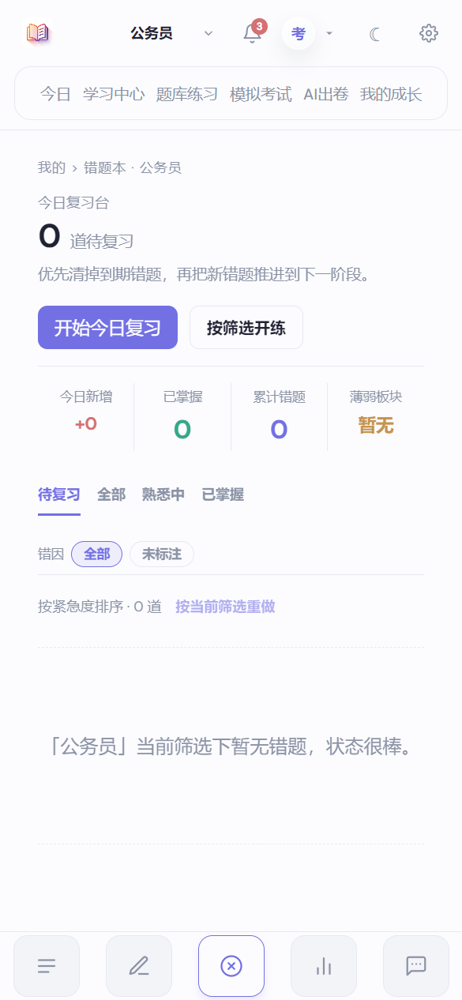
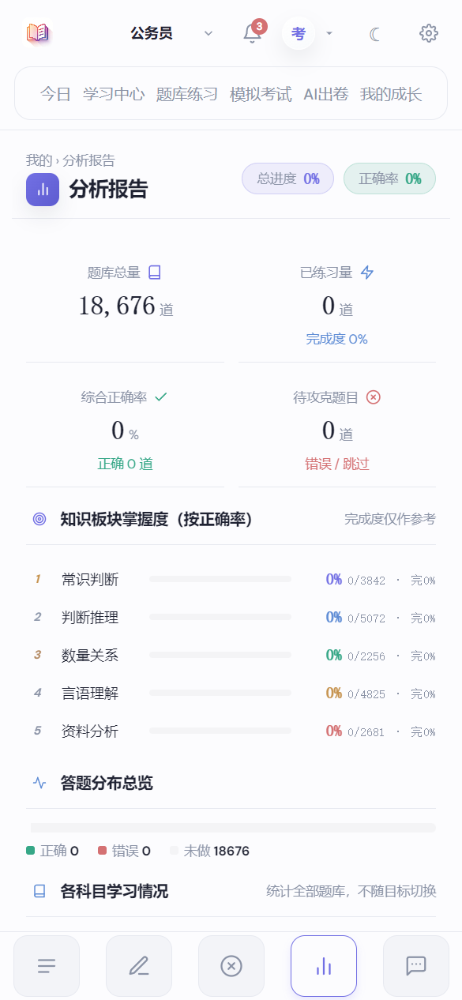

<p align="center">
  
</p>

<h1 align="center">OpenExam</h1>

<p align="center">
  本地优先的 AI 备考应用 · Electron 桌面 + 浏览器 / PWA
</p>

<p align="center">
  
  
  
  
  
  
</p>

<p align="center">
  智能出卷 · AI 辅导 · 题库包分享 · 成长体系 · 移动端适配 · 本地持久化
</p>

---

## 关于这个仓库

> **本项目基于原作者 [lmk1010/OpenExam](https://github.com/lmk1010/OpenExam) 二次开发。**
> 原作者：**lmk1010** · 官网 [openexam.cc](https://openexam.cc) · Android 端仓库 [lmk1010/OpenExamApp](https://github.com/lmk1010/OpenExamApp)
> 原始项目采用 **GPL-3.0-or-later** 发布，本仓库的修改同样遵循该协议，原始版权归原作者所有。

本仓库（`Tansea-web/OpenExam`）在保留桌面端原有能力的基础上，主要补齐了**手机 / 平板上的使用体验**与**题库分享链路**：

- **全站移动端适配**：≤1024px 自动切换为底部 Tab 栏 + 单列布局，答题、错题本、分析报告、设置等 20 个页面均无横向溢出。
- **PWA 支持**：基于 `sql.js + IndexedDB` 的本地数据桥，浏览器打开即用，可添加到桌面，支持离线；通过 GitHub Pages 一键发布。
- **题库包分享**：题库可导出为格式化 JSON，并自动携带**目标 / 科目 / 分类**定义；接收方导入后自动创建，无需手动配置。
- **首屏更快**：网页端不再内置 10MB+ 种子题库，题目通过题库包按需导入。
- **细节打磨**：统计卡居中、图表坐标轴对齐、按钮不再挤压标题等移动端视觉修正。

## 界面预览

**桌面端**

<p align="center">
  
  
</p>
<p align="center">
  
  
</p>

**移动端（PWA / 390px）**

<p align="center">
  
  
  
  
</p>

<p align="center">
  <sub>今日待办 · 学习中心 · 错题本 · 分析报告 · 我的成长 · AI 智能导师 · 成就系统 · 深色模式</sub>
</p>

## 核心能力

- `AI 出卷`：根据知识点、难度、题型快速生成试卷与练习。
- `AI 导师`：支持讲题、追问、知识点梳理、举一反三。
- `题库包`：一键导出 / 导入题库，自动携带目标、科目与分类，换设备和分享都简单。
- `题库导入`：支持图片 OCR、PDF、Excel、CSV、JSON 等多种来源。
- `错题闭环`：记录答题结果、错因与练习历史，形成复习闭环。
- `成长体系`：等级、成就、学习日历、阶段目标统一沉淀。
- `本地优先`：学习数据默认保存在本地，更适合个人长期积累；桌面端与网页端数据结构一致。

## 技术栈

| 层级 | 方案 |
| --- | --- |
| 桌面容器 | Electron |
| 前端界面 | React + Vite |
| 桌面数据库 | SQLite + better-sqlite3 |
| 网页数据库 | sql.js（WASM SQLite）+ IndexedDB 快照 |
| 离线能力 | Service Worker（导航 network-first，静态资源 cache-first） |
| AI 模型 | OpenAI / Claude / DeepSeek / 豆包 / Kimi / 通义千问 / 智谱 GLM |

## 快速开始

```bash
npm install

# 桌面端开发
npm run dev

# 构建桌面端前端
npm run build

# 打包（需要 Electron 环境）
npm run dist:win
npm run dist:mac
```

### 网页 / PWA

```bash
# 本地开发（浏览器）
npm run dev:web

# 构建静态站点到 dist-web/
npm run build:web

# 本地预览构建产物
npm run preview:web
```

网页端首次打开是空题库，需要导入题库包（见下节）。

### 网页端 AI（浏览器直连）

网页端没有主进程，AI 由浏览器直接请求模型服务（BYOK）：

- 设置 → AI 模型填好服务商与 API Key 后，可用「AI 老师对话」「分析报告诊断」「主观题 / 申论批改」；
- 密钥只保存在本机浏览器（明文），公用设备请勿填写；
- 能否直连取决于服务商的 CORS 策略，失败时会提示（可换服务商或改用桌面端）；
- AI 出卷、图片识题、错因归因目前在网页端仍不可用，需要桌面端。

## 题库包

题库包是一个格式化 JSON 文件（`openexam.pack.v1`），只包含试卷、题目与分类定义，不含学习记录、错题和 AI 配置。

**导出**：设置 → 数据管理 → 题库包 → 导出（可选按科目导出，文件更小）

**导入**：设置 → 数据管理 → 题库包 → 导入

导出时会自动附带这些试卷用到的 `taxonomy`：

```json
{
  "schemaVersion": "openexam.pack.v1",
  "papers": [ ... ],
  "taxonomy": {
    "tracks":     [{ "key": "gongkao", "label": "公务员" }],
    "subjects":   [{ "key": "xingce",  "trackKey": "gongkao", "label": "行测" }],
    "categories": [{ "subjectKey": "xingce", "key": "shuliang", "name": "数量关系" }]
  }
}
```

接收方导入后，缺失的目标、科目、分类会自动创建；答案格式异常的个别题目会被跳过并在结果里提示，不影响整包导入。

## 移动端调试

内置一个窄屏截图 / 回归工具：

```bash
# 先构建
npm run build

# 截取单个页面（默认 390x844）
npx electron scripts/mobile-check.js --page=center

# 滑到底部再截图（自动找页面内最高的滚动容器）
npx electron scripts/mobile-check.js --page=analytics --scroll=bottom

# 指定尺寸 / 输出目录
npx electron scripts/mobile-check.js --page=practice --size=768x1024 --out=./shots

# 全量回归：检查横向溢出、越界元素与标题遮挡
npx electron scripts/mobile-check.js --page=all
```

可用页面：`home` / `trackopen` / `notify` / `usermenu` / `practice` / `configmodal` / `wrong` / `analytics` / `ai` / `center` / `papers` / `aigen` / `growth` / `settings` / `history` / `import` / `essay` / `tomomodal` / `exam` / `result` / `all`。

## 部署（GitHub Pages）

仓库内置 `.github/workflows/deploy-web.yml`：推送到 `main` 后自动执行 `npm ci --ignore-scripts` → `npm run build:web` → 发布到 GitHub Pages。

Service Worker 策略：

- 导航请求 **network-first**：发版后普通刷新即可拿到新页面；
- 静态资源 **cache-first**（文件名带 hash）；
- 需要强制失效时提升 `src/web/public/sw.js` 里的 `VERSION`。

## 目录结构（节选）

```
main.js                  Electron 主进程（窗口、IPC、导出/导入题库包）
preload.js               预加载桥
src/main/                数据库、题库包校验、目标/科目配置
src/renderer/            React 界面（页面、组件、样式）
src/web/                 PWA 桥（sql.js + IndexedDB）、Service Worker、构建入口
scripts/                 构建、种子库、移动端检查等工具
docs/assets/readme/      README 截图
```

## 更新日志

- 最新版本说明见 `CHANGELOG.md`。

## 致谢

- 原作者：[lmk1010](https://github.com/lmk1010)，项目 [lmk1010/OpenExam](https://github.com/lmk1010/OpenExam)。
- 题库数据、题图与第三方资源的版权归其各自来源，使用时请遵循对应许可。

## License

**GPL-3.0-or-later**

- 本仓库代码采用 GNU GPL v3 或更高版本授权，原始版权归原作者 lmk1010 所有；
- 本仓库的修改同样以 GPL-3.0 发布；
- 第三方题库数据、图片资源与外部内容不默认归入 GPL 授权范围，需遵循其各自来源与许可说明。
